<p align="center">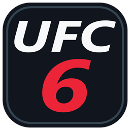</p>

<h1 align="center">UFC 6 Actions Overlay</h1>

<p align="center">
  Controller-friendly game actions and settings, drawn directly over UFC 6.
</p>

<p align="center">
  <a href="https://github.com/thyaguster/ufc6-actions-overlay/releases/latest"><strong>Download the latest release</strong></a>
  · <a href="#install-upgrade-and-remove">Install / Update / Remove</a>
  · <a href="https://github.com/thyaguster/ufc6-actions-overlay/issues">Report an issue</a>
  · <a href="THIRD_PARTY_NOTICES.md">Credits</a>
</p>

<p align="center">
  
  
  
  
</p>

## Quick installation

1. [Download the latest installer](https://github.com/thyaguster/ufc6-actions-overlay/releases/latest) — choose **UFC6-Actions-Overlay-Setup-*.exe**.
2. Close UFC 6 and PORTHEON, run the installer, and choose **PORTHEON\games\UFC6**. This is the launcher folder containing `UFC6.exe`, not your extracted game-data folder.
3. Click **Check folder**, then **Install / Update** for the original and Parsec engine. If you use **PS5 Pro / DLSS**, click **Switch engine: PS5 Pro**, check its **novo** folder, and install there too. The installer verifies each engine before enabling installation.
4. Launch UFC 6 normally. Hold **LB + RB + Menu/Start** for about one second, then release; **F10** also opens the overlay.

**One `bin` install covers both the original and Parsec/two-player mode. PS5 Pro / DLSS uses a separate `novo` install.** The Xbox game button-icons mod is included; no separate Python or button-mod installation is required.

**PORTHEON 6.2:** v0.9.8 recognizes and upgrades its bundled older overlay. Close the game and launcher and use **Install / Update**; do not manually delete DLLs. The standalone overlay works with the launcher's bundled-menu switch On or Off, including supported Parsec mode. Keep `ufc6_pthread_original.dll`: it is your original threading runtime, required by the startup bridge.

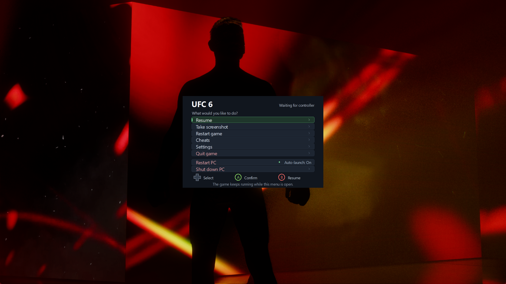

An in-process extension for the verified **PORTHEON UFC 6 `3309ab23f` original/Parsec engine** and **`09eaab2` PS5 Pro / DLSS engine**. It draws its menu directly into the game's Vulkan frames and keeps focus on the game. The main menu contains **Resume, Take screenshot, Restart game, Cheats, Photo Mode, Settings, and Quit game**, followed by a gap separating **Restart PC and Shut down PC**.

The engine executable is not modified on disk. The optional controller-icon patch changes verified game-asset ranges and keeps a local restore backup. The original/Parsec startup bridge forwards calls to your verified original threading runtime, preserved byte-for-byte as `ufc6_pthread_original.dll` and restored by the uninstaller. The PS5 Pro / DLSS bridge forwards timing calls to the Windows system library. A short-lived helper handles restart or confirmed shutdown after the game has exited and, when configured, after launcher cleanup.

This download contains the overlay, asset-free controller-icon patcher, and installer. UFC 6, the emulator/launcher, firmware, keys, and other game content are not included. The installer checks the executable hash before installing; other KytyPS5 builds are not automatically supported.

**The [UFC 6 Xbox Icons mod](https://github.com/thyaguster/ufc6-xbox-icons) is already included in this overlay.** You do not need to download or install it separately. Use **Settings → Game & launcher → Patch in-game controller icons...** to change the game’s button prompts between Xbox and the original PlayStation icons.

## New in v0.9.45

- **PS5 Pro / DLSS engine:** the overlay now starts and draws in PORTHEON's verified `novo` engine. F10, controller navigation, screenshots, Photo Mode and replay controls were verified in the game. The installer has a **Switch engine: PS5 Pro** button and keeps each engine's installation separate.
- **New-engine bridge:** `winmm.dll` forwards the engine's timing calls to Windows and starts the per-game Vulkan layer. The installer verifies the exact engine hash and backs up recognized overlay files; it does not change the game executable or system Vulkan settings.
- **Career and startup controls:** the shared game-code hooks verify their signatures before use on the new engine. Career edits still require a loaded career and a save backup. Background audio muting remains unavailable on the new host engine until its native audio hook is verified.

## New in v0.9.44

- **Instant Replay duration:** the Photo Mode Replay page retries transient recorder reads and ignores older intervals that cannot be mapped into the current replay. It shows “Checking continuous footage” while measuring. The duration was verified in a live Parsec fight.

## New in v0.9.43

- **Replay duration:** the Photo Mode Replay page shows the available continuous footage length separately from the selected clip. Older footage may have been trimmed.
- **Photo Mode presets:** cycle to the new Presets page, choose one of three slots, and save or apply the current filters, watermark style, FOV, HUD and cage settings. Slots persist across launches and use the current PORTHEON player name. Camera position stays with the current fight.

## New in v0.9.42

- **Photo Mode exit:** the F9 shortcut now requests exit immediately, and the translucent panel follows the camera/input state. Quick entry/exit from Instant Replay's Replay page was verified in Parsec mode; the panel cleared every time.

## New in v0.9.41

- **Photo Mode exit:** quick F9 presses are detected more reliably, including while Shift is held for faster camera movement. The remaining panel issue in this version was addressed in v0.9.42.

## New in v0.9.40

- **Instant Replay Photo Mode:** the camera and replay-step controls work in the game's mid-fight Instant Replay when playback is inside the recorded clip. Photo Mode now releases its panel and controller lock immediately when exiting; the native camera restores on its game callback.

## New in v0.9.39

- **Experimental Instant Replay:** enable it before a new offline fight to expose the game's own Instant Replay entry in its pause menu. Starts Off.
- **Simpler startup settings:** the optional visual auto-confirm fallback is under Experimental; Skip intros and Suppress online notices remain in Game & launcher.
- **Next hit KO timing:** arming waits for a verified fighter update and remains armed while a fight is paused.

## New in v0.9.36

- **Replay editor:** pause, rewind/step forward, 10 ms–1 second steps, Native or 0.1×–2× playback speed, controller shortcuts, free camera and zoom.
- **Available recording:** browse and play earlier retained footage, then restore the original Finish clip. Retention varies; this is not a guarantee of whole-fight recording.
- **Replay after decisions:** enable under Settings → Game & launcher before a new offline fight. Uses retained clips when the game did not select a complete recap; repeated replay entry and rematch cleanup are verified.
- **Next hit KO:** arm a clean head-strike KO against the opponent, cancel it, or let it expire after 25 seconds. The normal finish replay remains available.
- **Mute when unfocused:** optional game-audio muting while minimized or using another application, with sound restored on return.
- **Photo effects and watermarks:** live translucent editors, filters, adjustable effects, styled player-name text with font, size and color controls.
- **Startup and performance:** native title/network-warning bypass, intro skipping, and PORTHEON crowd/effect/render-scale controls.

[Full screenshot gallery](docs/SCREENSHOTS.md) · [Replay and Photo Mode guide](docs/PHOTO-MODE.md) · [Release history](RELEASE-NOTES.md)

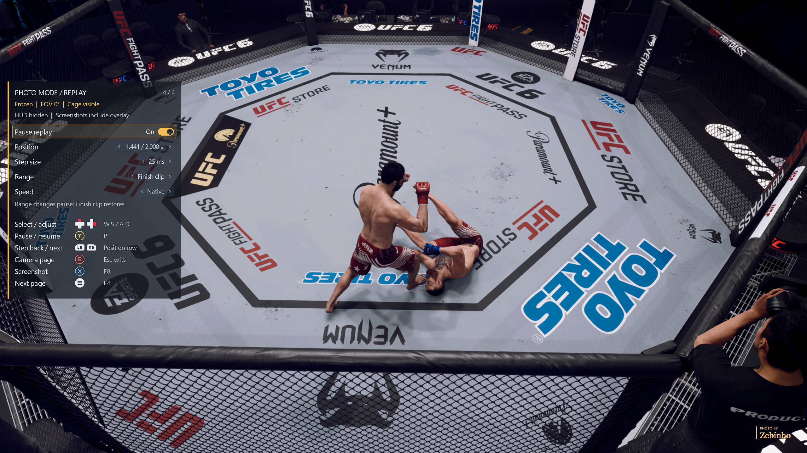

## Parsec / two controllers

PORTHEON's **Parsec mode** uses a separate `UFC 6 Parsec.exe` with its own two-player routing. Version 0.8.4 supports the verified derivative with SHA-256 `ad94dc7e30ad12c8078d14d96520c1d48d4b0c658604cc3dcc1d68a3e228773d`. It preserves the routing wrappers using checked nearby relay padding; unknown engine revisions or occupied padding are rejected. The engine file is not modified or distributed.

Install into the same `bin` folder, then launch with PORTHEON's Parsec option enabled. Either pad can open a new menu; Guide and F10 let the first fresh navigation press claim the menu through XInput or the game's controller input. Xbox opening combinations use the matching XInput pad when available. Other pads cannot navigate an already-owned menu. Both pads are withheld from gameplay while the menu is open, and held digital buttons must be released before gameplay input resumes. Restart and quit recognize both supported engine filenames. This does not add Parsec networking or two-player routing itself; those remain PORTHEON's features.

## Performance

**Settings → Performance** controls crowd rendering/animation, particles and sparks, depth of field, dynamic resolution and 3D render scale through PORTHEON's existing settings. Use **Save for next launch**, or **Save & restart game** with confirmation. These changes require a restart; normal and Parsec mode share the same settings. Other launcher configuration and fixes are preserved. See [Performance settings](docs/PERFORMANCE.md).

## Photo Mode

Open **Photo Mode** from the main overlay menu, or press **F9**, during a running fight, practice or the game’s View Replay. Move the free camera, adjust its field of view, freeze the action, hide the game HUD and keep cage panels visible. Closing Photo Mode restores the normal camera and game speed; switching away from the game also exits it.

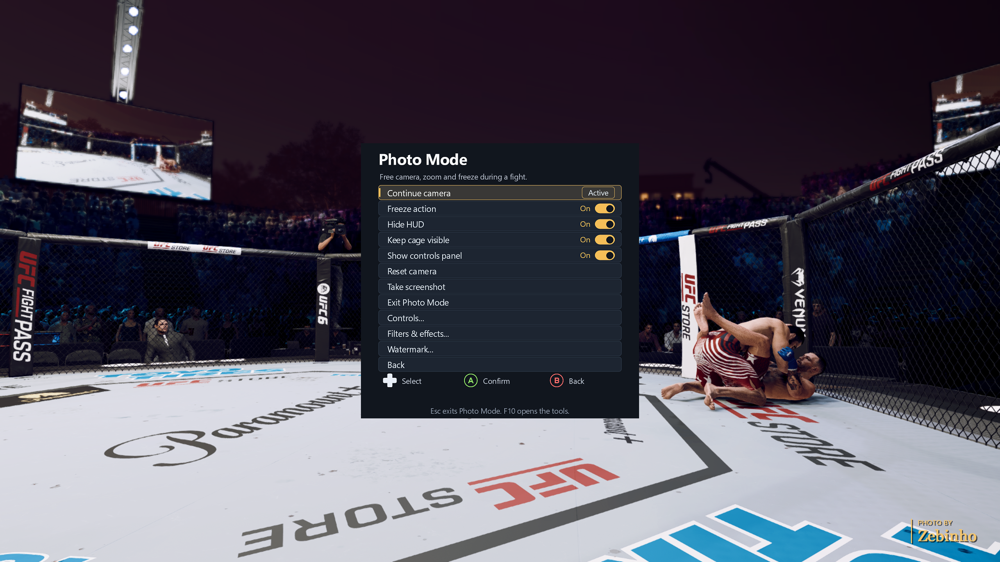

| Action | Controller | Keyboard |
| --- | --- | --- |
| Move camera | Left stick | I / J / K / L |
| Look around | Right stick | Arrow keys |
| Move up / down | LB / RB or L1 / R1 | U / O |
| Zoom (field of view) | Triggers | Page Up / Page Down |
| Freeze / unfreeze | A / Cross | P |
| Clean screenshot | X / Square | Your assigned screenshot key |
| Reset camera | Y / Triangle | Home |
| Hide / show game HUD | D-pad Up | H |
| Toggle cage visibility | D-pad Right | C |
| Hide / show controls panel | D-pad Down | Tab |
| Exit Photo Mode | B / Circle | Esc |

Hold **Shift** for faster keyboard movement. These camera controls apply while the tools menu is closed; **F10** opens the tools. The translucent panel follows the selected Xbox/PlayStation icons, theme, font and UI scale and sits below the fighter HUD. Gameplay input is withheld while the camera is under Photo Mode control.

**Keep cage visible** prevents the normal gameplay camera's fence fading from leaving missing panels in free-camera views. Turn it Off for native fading. If the action is frozen, briefly unfreeze to let a changed cage setting update. Your selected HUD visibility is preserved while the tools menu is open.

Screenshots are clean by default. Enable **Settings → Files & support → Include overlay in screenshots** when you want to capture the tools or translucent panel; the normal screenshot button/key follows that switch. No separate controller shortcut or overlay-shot action is installed. Capture mode does not remove photo effects or the optional player-name watermark. PNGs save to **Pictures\Screenshots**.

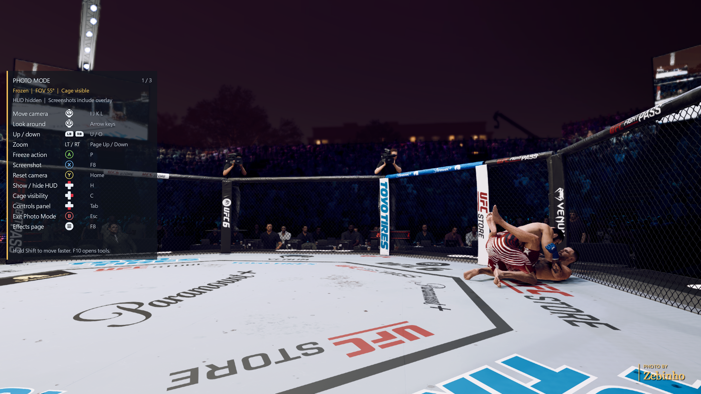

See the [Photo Mode guide](docs/PHOTO-MODE.md) for availability and restoration details.

## Diagnostics and support reports

Use **Settings → Files & support → Export support report...**, then **Export support report** in the desktop window. If the overlay is invisible, run the installer, select your game folder, click **Check folder**, and use **Export support report...** there. Export does not require installing or closing the game. Keep the game running to include its loaded modules.

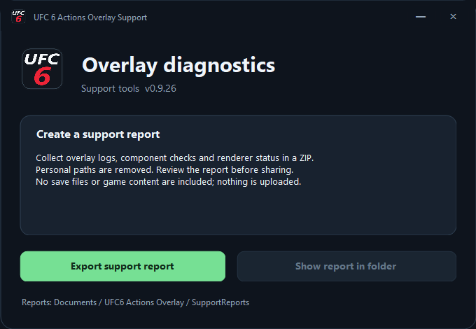

Reports are stored in **Documents\UFC6 Actions Overlay\SupportReports** as unique ZIP files. They contain component hashes and comparisons with the reporting build, supported-engine checks, loaded overlay module names, renderer state when opened from the overlay, the last 512 KiB of each of the two overlay logs, and bounded, path-redacted Vulkan-loader messages from the two newest PORTHEON logs. Missing files and logs are recorded. Logs may include earlier sessions; v0.9.9 adds a core build marker to distinguish them.

Windows and network paths are redacted. Saves, screenshots, launcher arguments, account details and game content are excluded. Nothing is uploaded; review the ZIP before sharing it in an issue. The desktop window's **Show report in folder** button selects the saved archive.

[Startup screens](docs/STARTUP.md) · [Planned additions](docs/ROADMAP.md) · [Photo Mode guide](docs/PHOTO-MODE.md)

## Next hit KO

In **Cheats**, select **Next hit KO** to arm it for Player 1’s opponent in a supported offline fight, with Photo Mode Off. Select it again to cancel. Resume and land a clean head strike within 25 seconds. If the fight is paused while you arm it, the request waits for the next verified fighter update. It automatically disarms after the KO or timeout; it does not choose a winner without a strike. Cancel, opponent-only KO, automatic disarm and the normal finish replay are live-tested.

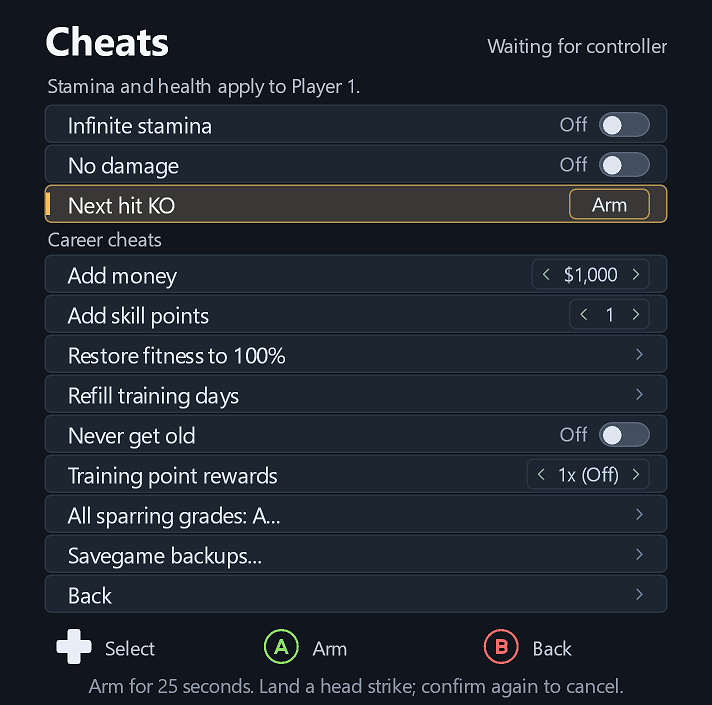

## Background audio and decision replays

**Settings → Game & launcher → Mute when unfocused** mutes only UFC 6 while it is minimized or unfocused and restores audio on return.

**Replay after decisions** starts Off. Turn it On before a new offline fight to offer View Replay after a decision when valid retained clips exist. An incomplete recap may repeat clips. It does not manufacture missing recordings. Draw-specific playback remains on the roadmap; decision playback, repeat entry and rematch cleanup are confirmed.

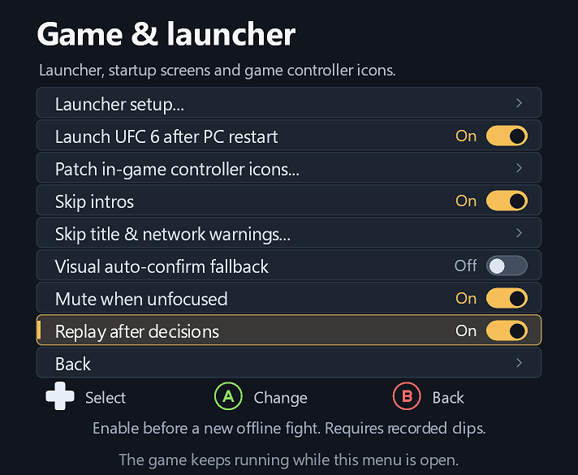

## Screenshots

<table>
<tr>
<td width="50%">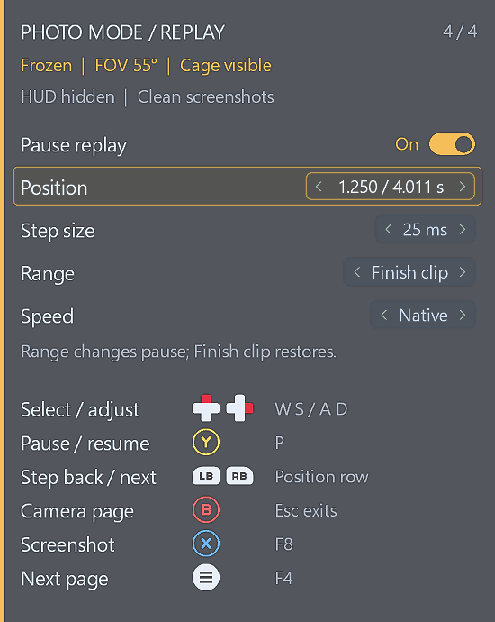<br><strong>Replay timeline and speed</strong></td>
<td width="50%"><br><strong>Decision replays and background audio</strong></td>
</tr>
<tr>
<td width="50%"><br><strong>Next hit KO and career cheats</strong></td>
<td width="50%">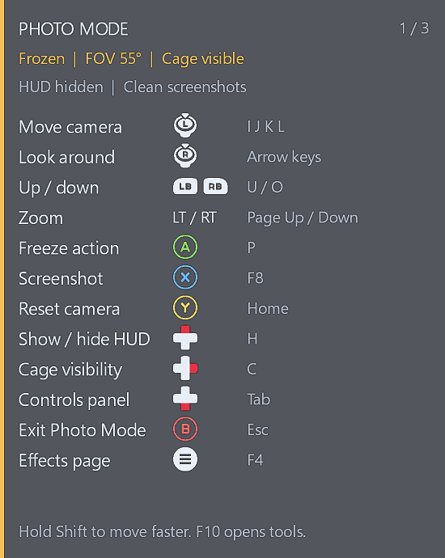<br><strong>Photo Mode camera controls</strong></td>
</tr>
<tr>
<td width="50%">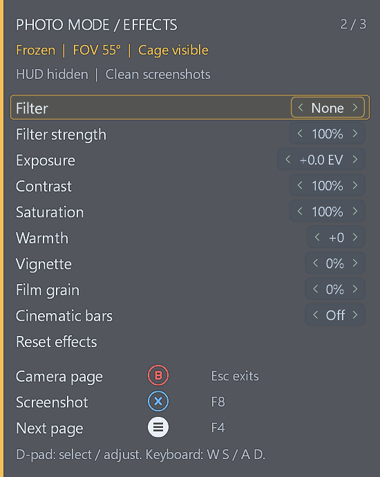<br><strong>Live filters and effects</strong></td>
<td width="50%">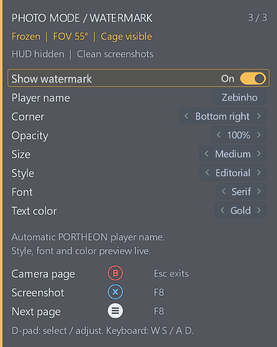<br><strong>Styled watermark and colors</strong></td>
</tr>
<tr>
<td width="50%">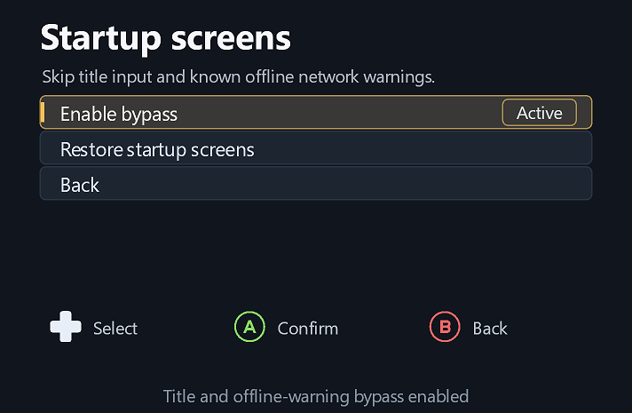<br><strong>Native startup bypass</strong></td>
<td width="50%">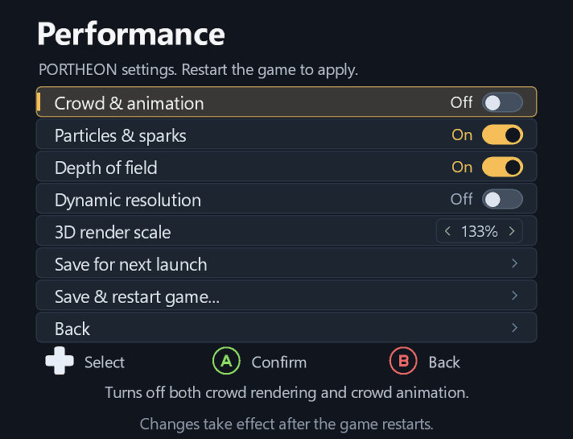<br><strong>PORTHEON performance controls</strong></td>
</tr>
<tr>
<td width="50%">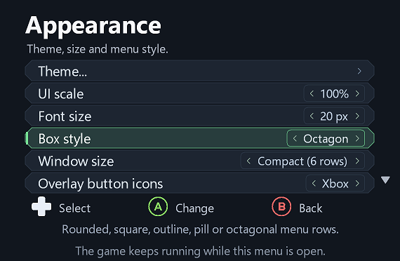<br><strong>Appearance and window sizing</strong></td>
<td width="50%">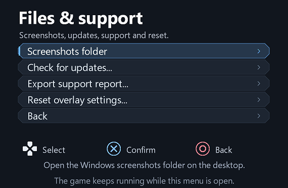<br><strong>Optional overlay-inclusive screenshots</strong></td>
</tr>
</table>

[Browse every current overlay page](docs/SCREENSHOTS.md).

[Controls](docs/screenshots/controls.png) · [Game & launcher](docs/screenshots/game-launcher.png) · [Files & support](docs/screenshots/files-support.png) · [Screenshot notification](docs/screenshots/notification.png) · [Windows setup](docs/screenshots/setup.png) · [GitHub updater](docs/screenshots/updater.png)

The isolated page images use the current overlay renderer in a test host with power actions disabled. The game-background captures show an earlier overlay release running over the actual game.

## Change in-game controller icons (included)

The overlay includes the patcher from [UFC 6 Xbox Icons](https://github.com/thyaguster/ufc6-xbox-icons), so one overlay installation provides both the actions menu and the game button-icons mod.

1. Open the overlay and go to **Settings → Game & launcher → Patch in-game controller icons...**. It is in the Game & launcher category.
2. Choose **Xbox game icons** or **PlayStation game icons** on the **Controller icon patch** page. It also shows which icons are currently installed.
3. Confirm **Apply and restart game**. The game and its launcher close normally, the patch is applied, and UFC 6 relaunches through your saved launcher settings.

**Overlay button icons** changes the prompts inside this overlay. **Patch in-game controller icons...** changes the prompts inside UFC 6 itself; the two choices are independent.

The game-icons patch supports extracted **PPSA23566 01.006.000** game files. It verifies the files and keeps a local `.ufc6-xbox-icons-backup.zip` for restoring the original PlayStation icons. The download contains the patcher, not game artwork or game files. Uninstalling the overlay keeps the patched icons and restore backup; choose PlayStation icons first if you want the original artwork restored.

[View the controller-icon patch page](docs/screenshots/game-button-icons.png) · [Standalone button-icons mod and documentation](https://github.com/thyaguster/ufc6-xbox-icons)

## Updates through GitHub

Open **Settings → Files & support → Check for updates...** in the overlay, or click **Check for updates** in the installer. This opens a desktop window (mouse/keyboard required) that compares your installed version with the latest stable GitHub release.

If an update is available, click **Download & open installer**. The updater checks the release checksum and SHA-256 of the downloaded EXE before opening it. Your game folder is filled in automatically. **Close UFC 6 and its launcher**, then click **Install / Update**. One update covers normal and Parsec mode; settings, screenshots, game-icon restore backups and savegame backups are kept.

Updates are checked when you open the checker; nothing is downloaded or installed silently at game startup. The original setup remains available from [GitHub Releases](https://github.com/thyaguster/ufc6-actions-overlay/releases/latest). Users on v0.9.3 or earlier should run the latest setup once to add the updater.

## Controls and Settings

- Default opening shortcut: hold **LB + RB + Menu/Start** for **0.8 seconds**, then release. On PlayStation this is **L1 + R1 + Options**.
- **D-pad or left stick up/down** selects; **A / cross** confirms; **B / circle** goes back. Back resumes the game from the main menu.
- **F10** always opens or closes the overlay, including while recording a new shortcut.
- After opening with Guide or F10, release the opening button, then use the D-pad. Guide accepts navigation from either XInput or the game's controller input, with ownership assigned to the first fresh navigation press. Xbox combinations use the matching XInput pad when available. Buttons held or released on another pad do not take ownership or block arming. Disconnecting the controlling pad closes the menu safely.
- The Xbox/Guide button opens or closes the overlay by default. Disable it under **Settings → Controls → Xbox / Guide button** if you use that button for something else. This controls only this overlay. Windows Game Bar and other apps may also use Guide; use the separate Windows Game Bar setting below to resolve that conflict.

Select **Settings** and choose a category. The available controls include:

- **Overlay button icons:** left/right or confirm switches this overlay between Xbox A/B and PlayStation cross/circle prompts.
- **Patch in-game controller icons...:** choose Xbox or the original PlayStation artwork independently. The Cancel-first confirmation applies the selected theme after the game and its launcher close, then relaunches through your saved launcher settings. It supports extracted PPSA23566 01.006.000 and creates/verifies `.ufc6-xbox-icons-backup.zip` in the game folder. No game assets are bundled. Existing development installs must first be migrated/restored with their original tool; unknown data is left untouched. Uninstalling the overlay keeps game artwork and the backup; restore PlayStation icons before uninstalling if desired. This is labeled **Controller icon patch** on its own page.
- **Opening shortcut:** confirm starts recording. Release the confirmation button, hold a combination of **2–4 digital buttons** for about half a second, then release to save it. Supported buttons are shoulders, stick clicks, D-pad, face buttons, and Menu/Options. Analog triggers and Guide are not recorded. B/circle alone cancels recording; F10 closes the overlay without changing the shortcut.
- **UI scale:** left/right changes the whole overlay from **50% to 300%**, in **25% steps**. Confirm resets it to **100%**. The overlay stays centred and automatically shrinks to fit smaller game windows with a margin. Text and shapes are rendered at twice the final pixel resolution and downsampled for smoother edges at every scale. Unchanged pages reuse their rendered image; selections, switches and other visible changes redraw it.
- **Launch UFC 6 after PC restart:** On by default. Confirm or left/right toggles whether Restart PC reopens UFC 6 at your next Windows sign-in. The Restart PC row and its confirmation show the current On/Off status; the confirmation also points to Settings.
- **Xbox / Guide button:** On by default. Confirm or left/right toggles opening/closing this overlay with Guide. The controller shortcut and F10 stay available when Off. The preference saves automatically; enabling it while Guide is already held requires releasing and pressing again.
- **Windows Game Bar shortcut:** shows Windows' actual controller-shortcut preference. Confirm or left/right changes it for the current Windows user. Turn it **Off** if Guide opens this overlay but navigation stalls; Game Bar can redirect controller input even with no visible window. **Win+G** still opens Game Bar. This setting affects other games too and persists after uninstall. Startup and setup only read it; they never change it automatically. Use the fallback controller combination or F10 to reach Settings if Guide is intercepted.
- **Game Bar conflict warning:** if Windows reports controller input redirected to Game Bar while this menu is open, an amber warning stays visible until input returns. It shows your configured fallback shortcut with Xbox/PlayStation labels and F10, plus recovery instructions. PC power holds/countdowns cancel when redirection begins. Detection only reads Windows state; it never changes the Game Bar preference automatically.
- **Launcher setup...:** opens a desktop configuration window (mouse/keyboard required). The game minimizes while it is open and restores afterward. Leave Custom unchecked for the current PORTHEON defaults, or browse to another launcher **or the supported game engine itself** and enter its launch arguments. The start folder defaults to the executable's folder when blank. Leave **Wait for the previous launcher to exit** Off for launchers that stay open; PORTHEON keeps its cleanup wait. These settings apply to both Restart game and post-reboot auto-launch. Launcher selection does not add support for unknown engine builds.
- **Controller access:** **Either** by default, or **Player 1 only**. The top-right indicator shows the player owning navigation, or waits for an eligible fresh press. Other controllers cannot navigate an owned menu. Switching access releases the old owner; held navigation controls must be released before claiming again. A newly eligible held Guide button also needs releasing and pressing again. Player 1-only applies to controller navigation, opening combinations and Guide; **F10 always remains available**. Native input follows the verified engine's active player IDs (including Parsec Player 2); direct XInput uses Windows slots 1-4, with slot 1 as Player 1. If native input has no known player assignment, the badge says Controller instead of inventing a player number. Settings scrolls to keep the selected row visible.
- **Screenshots folder:** opens the Windows screenshots folder in Explorer and minimizes the game. Available even before taking a screenshot.
- **Reset overlay settings...:** opens a confirmation with **Cancel** selected. Reset restores icons, shortcut, scale, post-restart game launch, Guide, controller access, and launcher defaults. Saved screenshots and the Windows Game Bar preference are kept. If saving fails, previous settings remain active.
- **Check for updates...:** opens the GitHub update checker on the desktop. The game minimizes; mouse/keyboard is required.
- **Back:** returns to the main menu.

Preferences save automatically to `bin/ufc6-quit-menu.ini` and are preserved when upgrading. A custom shortcut uses the same 0.8-second hold time. The INI can also be edited while the game is closed:

```ini
[Menu]
ButtonIcons=PlayStation
OpeningShortcut=0x00000c08
UIScale=100
AutoLaunchAfterRestart=1
GuideButtonOpensMenu=1
ControllerAccess=Either
```

`Xbox` is the other icon style. The hexadecimal value above is the default shoulder/Menu combination; use the recorder to choose a different combination.

The menu does **not pause emulation**. Its opening combination can trigger normal game bindings during the hold. While open, controller buttons and sticks are neutralized and withheld from the game until the menu closes and buttons are released. Native touchpad/motion paths are not intercepted.

On/Off choices use labeled pill switches. Adjustable values use compact arrow controls, and the selected row has a green outline. Quit and PC power actions use a separate muted red accent.

## Startup controls

Under **Settings → Game & launcher**, **Skip intros** skips the Zuffa and EA SPORTS splashes using the checked short-boot route and its supporting timer settings. Both splashes are confirmed completely absent in a live Parsec launch. Turning it Off restores the normal intro callbacks. The older separate shortening preference is ignored.

Switching **Skip intros** On also enables **Suppress online notices** and the optional **Visual auto-confirm fallback**. Each can then be turned Off independently. Switching Skip intros Off turns both Off. **Suppress online notices** prevents the later offline-progression popup, including after a fight; the change takes effect immediately.

**Skip title & network warnings** uses the game's native startup flow to bypass title input and the known offline warnings after a restart. **Visual auto-confirm fallback** is under **Game & launcher → Experimental** for configurations where the native bypass cannot be used. It recognizes the English 16:9 startup prompts at 720p or higher while the game is focused. It is optional because different graphics drivers or layouts can change the prompt image.

**Instant Replay in fights** is also under **Game & launcher → Experimental** and starts Off. Turn it On before loading a new offline fight; the game's own pause menu can then offer Instant Replay. In a tested Parsec fight, the post-fight menu also offered **Instant Replay** alongside **View Replay**: Instant Replay opened the native seek-bar viewer over the retained recording, while View Replay used the game's selected finish clip. The user could seek to the start, play and exit the post-fight Instant Replay. Longer fights may have earlier footage trimmed, so whole-fight playback is not guaranteed. If the current fight's menu was already built, enabling the switch may need a new fight. Turning it Off restores the verified in-memory game callback; in the Parsec test, the entry disappeared from the same fight's pause menu. No game files are edited.

## Keybinds and themes

Settings is grouped into **Appearance**, **Controls**, **Game & launcher**, and **Files & support**. Appearance contains theme, UI scale, a consistent font-size control (16/18/20), a separate window-size control, five row styles (Rounded/Square/Outline/Pill/Octagon), and overlay button icons. Assigned shortcuts and footer controls use the selected Xbox or PlayStation vector artwork, including platform-specific shoulder, stick-press, D-pad and Options/Menu prompts. Brief corner notifications report actions and screenshot results without opening the menu or taking input; screenshots exclude those notifications.

**Window size** is separate from UI scale: Compact allows six rows before scrolling, Expanded allows nine, and Tall allows up to twelve. Long pages grow vertically while keeping the font size unchanged; short pages use only the height they need. Tall shows all eleven Cheats rows together. The overlay still fits inside the game viewport.

**Settings > Controls > Keybinds** assigns a keyboard key (optionally with Ctrl, Alt or Shift) and a controller combo to each action: open overlay, screenshot, Cheats, Settings, savegame backup, restart game, quit game, restart PC and shut down PC. Select an action, record the input, then release it to save. Controller combos use two to four buttons held for 0.8 seconds. Reserved or overlapping bindings are rejected. F10 remains available to recover access, and Guide keeps its existing setting. Assigned shortcuts appear beside menu actions. Restart, quit and power shortcuts open confirmation pages; PC power actions retain their hold/countdown. Screenshot shortcuts capture the game without the overlay.

**Settings > Appearance > Theme** offers Green, Blue, Red, Purple and Amber presets. **From config** is the default: it follows `bin/ufc6-overlay-theme.cfg`, allowing PORTHEON to supply colors that match its launcher. The overlay creates an example file only when none exists, preserves it during updates/reset, and reloads it while the game is running. A user-selected preset is stored separately in the overlay INI; selecting From config resumes following the launcher's colors.

Example config (also available as [a downloadable example](docs/theme-config.example.cfg)):

```ini
[Theme]
Preset=Blue
Accent=#66B1FF
Background=#11161E
Surface=#1D2531
Border=#2A3544
Text=#DAE4F0
Muted=#B0B8C5

[Appearance]
UIScale=100
FontSize=18
BoxStyle=Rounded
WindowSize=Compact
```

On first launch, `[Appearance]` seeds any missing `UIScale`, `FontSize`, `BoxStyle` and `WindowSize` preferences, then saves them to the client INI. Existing values and later user edits are preserved, even if the launcher changes these defaults afterward. Scale accepts 50–300 in steps of 25; font size accepts 16, 18 or 20; box style accepts Rounded, Square, Outline, Pill or Octagon; window size accepts Compact, Expanded or Tall. Color config still reloads live while From config is selected.

All color overrides are optional and use `#RRGGBB`. Invalid colors fall back to the preset. PORTHEON can distribute just this config; no overlay rebuild is required. User bindings live in the INI's `[Keybinds]` section, and Reset clears those bindings and the theme override while keeping the launcher's theme config.

## Cheats

**Savegame backups...** opens a page with **Create savegame backup** and **Open backups folder**. Save your progress in UFC 6 and wait for autosaving to finish first. Backups contain the files already on disk, including UFC 6 saves for the default user and guest users; unsaved progress is not included.

Each backup is a separate timestamped ZIP in your Windows **Documents / UFC6 Actions Overlay / SaveBackups** folder (including redirected Documents locations). The ZIP preserves the `_SaveData` paths and includes `backup-manifest.json` with file sizes and SHA-256 hashes. The helper verifies the source again and checks the ZIP contents before marking it complete. Detected save changes or copy failures discard the incomplete ZIP; original saves and older backups are kept. The copy runs in the background, and game cheats remain separate from backups. Uninstalling the overlay leaves these backups in place.

The Cheats page also includes **Add money** and **Add skill points** for the loaded offline career. Select a row, use left/right to choose an amount, then confirm **Add now**. Opening the confirmation or changing amounts does not modify a balance. If pending, resume and reopen a career page within 30 seconds so the game's career lookup applies the addition. Balances are shown below the rows.

**Restore fitness to 100%** is a one-time career action with a Cancel-first confirmation. It uses the selected career fighter's verified `Fitness` field and the game's setter/change tracking, preserving neighboring packed values. Resume and reopen a career screen if the action is queued. This sets fitness once; it does not freeze fitness or remove injuries. Back up your saves before testing career changes.

**Never get old** remembers its On/Off choice between launches. A saved On choice activates only after the selected career and field binding are verified; missing or changed data is left untouched until a fresh valid binding is available. It preserves the current amount, allows increases and forwards fitness, currency and other fighters' writes normally. Turning it Off immediately restores normal loss and saves Off. Reset clears the saved choice to Off. It does not refill longevity already lost. A blocked-decrease entry is added to the support log for verification.

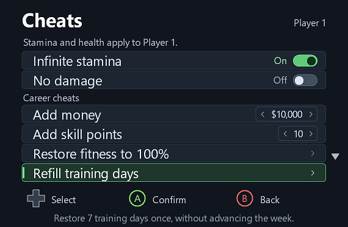

**All sparring grades: A...** records Grade A for the selected career's sparring challenge packs, including unattempted packs, after confirmation. This unlocks simulation for those drills; it does not unlock training stations or change their levels. Resume and reopen training selection if the action is queued, and save normally.

**Training point rewards** offers **1x (Off), 2x, 5x and 10x**. Choose a multiplier before starting training. It scales verified training-objective skill-point rewards from their original amounts, so changing multipliers does not compound them. Switching to 1x or resetting restores the original rewards. The choice is remembered between launches. Validated live at 2x in a Parsec heavy-bag session: three normally 2-point challenges awarded 4 points each, and the career balance rose from 46 to 58. Automated checks also cover 1x restoration, 5x/10x scaling, changing factors without compounding, limits and saved settings.


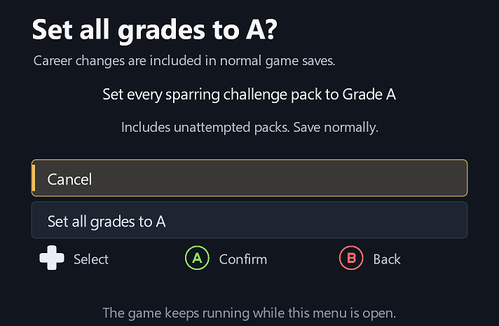

**Refill training days** restores the active camp's remaining training days to **7**, with confirmation. It follows the selected fighter's checked camp reference and current record row, and leaves the training week unchanged. Requests are cancelled if the career, camp, week or packed storage changes. It applies once; days can be spent normally afterward. It is unavailable outside an active training camp.

These are one-time additions, saved through the game's normal saving. Keep a save backup before experimenting. Money choices are 1,000 / 10,000 / 100,000 / 1,000,000 / 10,000,000; skill-point choices are 1 / 5 / 10 / 25 / 50 / 100 / 250 / 500 / 1,000. The current verified schema allows up to 2,147,483,647 money and 16,383 skill points. Requests exceeding the actual schema limit are rejected. This changes career skill points, not fighter rating points or online currencies.

Career checks are limited to four probes per second and cache verified schema positions; other lookups only forward to the original game function. Confirming an addition requests an immediate probe.

Career additions execute on a checked default-user career lookup hook using the game's integer setter and change tracking. Root identity, collection, named schemas, row counts, packed buffers and limits are validated before each addition. Changed careers/buffers, missing users and requests not applied within 30 seconds cancel the request. Reset cancels pending additions; it cannot undo additions already saved by the game. Both engine modes use the same verified guest game code.

Open **Cheats** from the main menu. **Infinite stamina** and **No damage** show your selected **On/Off** choice and apply only to **Player 1**. You can select On before entering a fight; it applies automatically when Player 1 is bound. The **Career cheats** heading separates money and skill-point additions from the fight toggles. Confirm or left/right toggles each cheat. Choices last for the current game session.

Player 1 is resolved from the game's `Fighter_ControllerInputMask` binding, so the cheat follows controller assignment rather than assuming fighter index 0 or using the fighter's current screen position. Ambiguous or unavailable assignments wait for valid game data. If controller assignment changes, the old fighter's override is cleared before the new fighter receives it.

The mod uses a checked in-memory hook in the game's binding update. It changes Player 1's bound boolean on the game thread and then calls the original synchronization function, keeping the game's authoritative values consistent. The opponent is left alone. Off maintains a disabled value for fighters previously controlled by the overlay. Settings reset stops active cheats. Earlier damage or lost maximum stamina is not undone.

The hook waits for initialized named flags, validates its exact code signature, and uses the overlay's existing thread-freeze mechanism during installation. Names, binding types, controller masks, player indices and byte values are validated; relocated tables are handled without stale-pointer writes. The cheat hook supports verified game code 01.005/01.006. Other overlay features retain their existing support. No game/launcher files are changed by toggles.

PORTHEON launch-time cheats display **PORTHEON On** and remain under launcher control. Disable them in PORTHEON and restart once before using live overlay control. **Game On** means an unmanaged game/practice flag is already enabled; confirming requests Off for Player 1.

Stamina prevention and an unaffected opponent were verified in a fight. Native fixtures cover controller-to-fighter reassignment, stable Off, hook calling convention, relocated tables and failed writes. Player 1-only behavior has been confirmed in live testing.

## Screenshots

Choose **Take screenshot**. A full-resolution PNG is saved in the Windows **Pictures → Screenshots** folder, with a unique timestamped filename. The destination is resolved through the Windows Screenshots known folder, so folder redirection and OneDrive are respected. If that known folder is unavailable, the mod uses the Windows Pictures known folder plus `Screenshots`. The folder is created as needed. Existing screenshots in the old `bin/Screenshots` folder are left in place.

**Take screenshot** excludes the overlay by default. The optional **Settings → Files & support → Include overlay in screenshots** switch makes the same normal screenshot action save the frame with the currently displayed tools or translucent Photo Mode panel. Turn it Off for clean photos again. No separate controller/default-keyboard shortcut or screenshot action is needed. Both modes retain Photo Mode effects and watermark and save to Windows **Pictures\Screenshots**. The menu can remain open; feedback appears after capture and late results never reopen the overlay.

This captures the game swapchain, not the desktop. Screenshot capture requires a surface that supports transfer-source images; unsupported display modes report that capture is unavailable. The current rendering path supports 8-bit BGRA/RGBA SDR swapchains at least 320×240 pixels, not 10-bit HDR formats.

## Restart and Quit

**Restart game** opens a confirmation box with **Cancel selected initially**. Confirming **Restart now** starts the handoff helper and sends the engine its normal window-close request. The helper verifies the process paths, waits for the game to exit and starts the saved launch executable with its arguments and working folder. The default PORTHEON profile waits for its launcher to exit and runs `UFC6.exe --play --headless --ui-lang en`. Custom profiles can skip the launcher-exit wait for apps that stay open. Invalid launch configurations are rejected before the game is closed. No process is force-terminated, and the helper exits after handing off the launch. If the helper cannot start, the current game remains open. Unsaved progress can be lost when restarting.

**Quit game** sends the same normal window-close request as closing the emulator window.

## Shut down PC

**Shut down PC** opens a confirmation box with **Cancel selected initially**. Select **Hold to shut down**, release the buttons, then hold **A / cross for 3 seconds**. Releasing early cancels that hold. A **10-second countdown** then appears, with Cancel selected. Confirm, Back, or F10 cancels the countdown; switching apps or disconnecting the controlling pad also cancels it.

When the countdown finishes while the game is focused, the helper checks the Windows shutdown privilege before the game is closed. It then waits for normal game and launcher exit and requests **Windows power-off**, using no force flags. Other apps can present their normal unsaved-work/shutdown prompts. If preflight fails, the game remains running. Unsaved game progress can be lost if you complete shutdown.

Shutdown is never invoked during automated verification: a separately compiled helper replaces the power API with a marker file, and the offscreen UI DLL cannot call the production handoff. Its tests verify the 3-second hold, countdown, cancellation, focus loss, process-exit waits and non-forcing power-off flags.

## Restart PC and reopen UFC 6

**Restart PC** has its own confirmation with **Cancel selected initially**, a **3-second A / cross hold**, and a **10-second cancellable countdown**. Back, F10, switching apps, and controller disconnection cancel it just as they do shutdown.

With **Launch UFC 6 after PC restart On**, the helper checks reboot privileges and registers a one-time game launch for the current Windows user before allowing the game to close. It waits for normal game and launcher exit, then requests a Windows reboot without force flags. **Sign back into the same Windows account after the reboot**; the helper waits briefly and starts the saved launch executable with the same arguments and working folder used by Restart game. It opens a fresh game session; unsaved match progress is not restored. Windows passwords and automatic sign-in settings are not changed. With the setting **Off**, the same confirmed reboot occurs without registering or launching the game. This preference is saved automatically and does not affect Restart game.

The one-time command uses `HKCU\Software\Microsoft\Windows\CurrentVersion\RunOnce`, value `UFC6MenuResume`. Windows consumes that entry at sign-in; it does not create a permanent startup app. This follows Microsoft's [RunOnce mechanism](https://learn.microsoft.com/en-us/windows/win32/setupapi/run-and-runonce-registry-keys). A boot-time guard skips launching if you only sign out and back in without rebooting. Existing entries with this name are preserved and cause reboot preflight to fail. Unsupported command lengths also fail before closing the game. Process-exit timeouts, a rejected reboot request, or a Windows reboot-cancellation notification remove the entry created by the helper. If you manually cancel the reboot outside the overlay and later uninstall before signing in again, remove only that `UFC6MenuResume` value if it remains.

Verification uses the test helper with power APIs compiled out and a file in place of RunOnce. It checks reboot flags, waits, failure cleanup, registration conflicts, Windows cancellation messages, same-boot skipping, and a simulated post-reboot game launch. Both auto-launch modes are checked, including leaving unrelated registrations untouched when Off. `tests/icon_preview.py --auto-launch` checks the default, toggles, saved preference and status labels; `--reload-auto-off` verifies persistence in a fresh process. No real reboot is performed by the tests.

## Install, upgrade, and remove

Download the latest **`UFC6-Actions-Overlay-Setup-*.exe`** and double-click it. The setup EXE contains all overlay components; it can run by itself without extracting the source ZIP, installing Python, or compiling anything. It uses the Windows .NET Framework 4.x already present on standard Windows 10/11 installations.

1. Close UFC 6 and its launcher.
2. Click **Browse** and select **PORTHEON\games\UFC6**. The installer starts with its **bin** engine. For PS5 Pro / DLSS, click **Switch engine: PS5 Pro** to select **novo**. Install in both folders if you play with both engines.
3. Click **Check folder** if you typed the path manually. Choosing a folder with Browse checks it automatically.
4. Click **Install / Update**. The setup verifies the engine and bundled files, backs up recognized older versions, and installs the overlay.
5. Start UFC 6 normally. Hold **LB + RB + Menu** for about one second, then release, or press **F10**.

To uninstall, run the same setup EXE, choose the same folder, and click **Remove overlay**. Settings and screenshots are preserved. Setup refuses to modify a running game or overwrite files from an unknown mod. Changes roll back if installation or removal fails. The engine executable, game assets, and Windows startup settings are not changed by setup. For a protected game folder, Windows may require running setup as administrator.

Version 0.8.2 fixes startup when Windows prefers system DLLs, which can bypass an app-local `version.dll`. The bridge uses the engine's existing non-system runtime import and enables the Vulkan layer only inside the game process. It preserves the Windows security policy, checks all required overlay files before enabling the layer, and does not register a system-wide Vulkan layer. Production rendering is in-frame only; a desktop popup cannot appear behind the game. The installer accepts the verified original runtime and recognized overlay bridges, including PORTHEON 6.2's rebuild; it rejects unknown replacements. The original runtime must still be available in `libwinpthread-1.dll` or its preserved `ufc6_pthread_original.dll` copy.

The full **`UFC6-Actions-Overlay-*.zip`** also contains `UFC6ActionsOverlaySetup.exe`, the prebuilt files in `dist`, all source, build scripts, and licenses.

The Python command-line manager remains available for development and scripting with the original **bin** engine:

```powershell
python manage_menu.py status --bin-dir "D:\Games\UFC6\bin"
python manage_menu.py install --bin-dir "D:\Games\UFC6\bin"
```

Restart UFC 6 once after installing an update. Already loaded DLLs remain active until the game exits. Replace the example path with your own game's bin folder. If omitted, `--bin-dir` defaults to `bin` under the current working directory.

The installer manages `version.dll`, `ufc6_menu_layer.dll`, `ufc6_menu_layer.json`, `ufc6_menu_restart.exe`, `ufc6_menu_icons.exe`, and `ufc6_menu_update.exe` in the selected engine folder. In **bin**, it also manages the `libwinpthread-1.dll` startup bridge, preserving the verified original as `ufc6_pthread_original.dll`; uninstall restores it byte-for-byte. In **novo**, it manages a `winmm.dll` timing bridge that forwards calls to Windows. It verifies all hashes, backs up recognized older versions, installs the core last, and rolls back changes if a commit fails. Unknown files, including unrelated mods using `version.dll`, are left untouched. Settings, screenshots, diagnostic logs, and backups are preserved.

Close the game before uninstalling:

```powershell
python manage_menu.py remove --bin-dir "D:\Games\UFC6\bin"
```

Vulkan layer settings apply only to the game process; there is no system-wide layer registration. Restarting through the helper does not duplicate the layer settings. The old `attach_menu.py` development helper cannot enable the Vulkan layer in an already initialized graphics instance. Never unload an active menu DLL.

The installer accepts these exact engine SHA-256 hashes:

```text
f3c42126bd9df5c12cb69c1c57233a94ba024c50929ba0dfe20e715521f691a2
ace7a59392b47a776d469768f4ed1aef2c3395c26ac4ed57fd67661c2d6abe48
```

The DLL separately verifies the image size, timestamp, and hook bytes. The exact engine source is unavailable; the installed `licenses/UFC6/ENGINE.txt` identifies this revision. The public [two-player patch](https://github.com/Danteh3-lab/kytyps5-2player-patch) independently documents the same engine and controller functions.

## Build and verification

```powershell
python -m pip install --target .tools ziglang==0.17.1 PyInstaller==6.22.3 pyinstaller-hooks-contrib==2026.9
python -m pip install Pillow==12.1.0  # Screenshot/render verification
.\build-icons.ps1 -DependencyPath .tools
.\build.ps1
.\build.ps1 -Test
.\build-setup.ps1 -Test
.\package.ps1
python -m unittest discover -s tests -p 'test_*.py' -v
```

Official Vulkan headers and their licenses are bundled under `vendor/vulkan-headers`. End users do not need the compiler or Python to run an installed mod.

The setup is built with the Windows .NET Framework C# compiler. Its fixture tests exercise the same installation code used by the GUI, including every install/removal commit failing in turn, rollback, upgrade backups, unsupported engines, unknown mods, concurrent file changes, and preservation of user data. The embedded production payload hashes are checked too. Tests use temporary fixture folders and do not install into or close the user's game.

Verification includes:

- Menu state tests for separate pages, confirmation defaults, capture release gates, invalid/cancelled shortcuts, reopening, icon preferences, screenshot requests, and Quit.
- Exact controller-hook prologue tests with concurrent calls.
- Offscreen rendering of the actual DLL's menus, icon changes, restart confirmation, shortcut recording, and persistence in a new process (`tests/icon_preview.py`). Its `--scale` checks cover 50–300%, reset, viewport fitting, and saved scale. Tests use a separate `.test.ini` file.
- A real Vulkan loader/device/swapchain test that resizes the overlay through 50/100/175/200/300%, grows upload buffers, fits the viewport, and requests a screenshot while drawing the menu (`tests/vulkan_smoke.c`). Its saved PNG was decoded and every pixel matched the underlying test game image; no overlay pixels were present.
- The Windows known-folder destination was verified by `tests/screenshot_location.py`: it found the redirected Pictures/Screenshots location, verified a clean PNG there, and removed only that generated test image.
- A real restart-helper handoff against dummy game/launcher processes, including launcher cleanup waits, a rejected mismatched path, and paths containing spaces (`tests/restart_handoff.py`). The user's game is not involved.
- Shutdown and reboot hold/countdown/cancellation tests and stubbed handoffs (`tests/shutdown_handoff.py`, with `--reboot` for reboot/resume). The test binary is checked to contain no Windows power API import.
- Installer upgrade, rollback, conflict rejection, and preference-preservation tests.

The in-frame menu and controller navigation were confirmed in fullscreen UFC 6. Version 0.8.2 startup is covered by mitigation-policy, original-runtime forwarding/restoration, small-stack thread, and real GPU tests. PC power tests always use the stub helper and never reboot or shut down the machine.

Project source is GPL-2.0-only; see `LICENSE`. Other engine builds require separately verified hooks.
