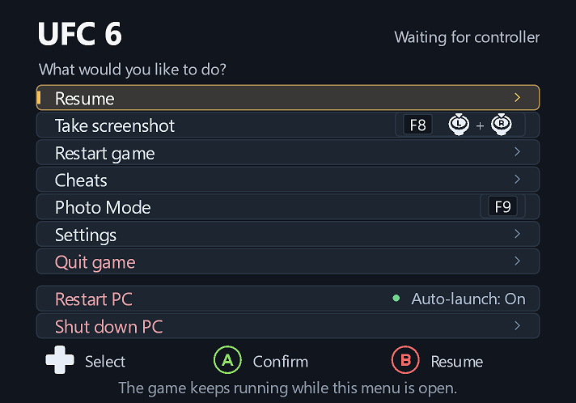
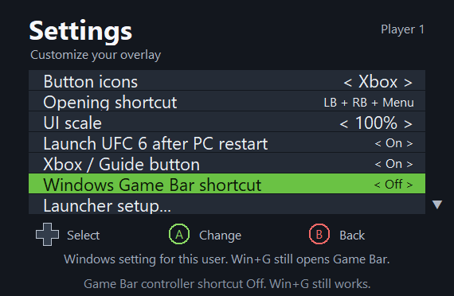
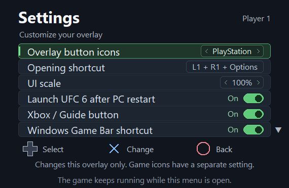
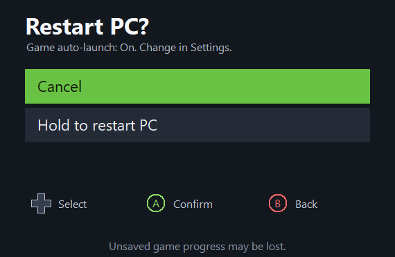

<h1 align="center">UFC 6 Actions Overlay</h1>

<p align="center">
  Controller-friendly game actions and settings, drawn directly over UFC 6.
</p>

<p align="center">
  <a href="https://github.com/thyaguster/ufc6-actions-overlay/releases/latest"><strong>Download the latest release</strong></a>
  · <a href="#install-upgrade-and-remove">Install / Update / Remove</a>
  · <a href="https://github.com/thyaguster/ufc6-actions-overlay/issues">Report an issue</a>
  · <a href="THIRD_PARTY_NOTICES.md">Credits</a>
</p>

<p align="center">
  
  
  
  
</p>


An in-process extension for the **PORTHEON UFC 6 `3309ab23f` Windows engine**. It draws its menu directly into the game's Vulkan frames and keeps focus on the game. The main menu contains **Resume, Take screenshot, Restart game, Settings, and Quit game**, followed by a gap separating **Restart PC and Shut down PC**.

The engine executable and game assets are not patched. A startup bridge forwards calls to your verified original threading runtime, preserved byte-for-byte as `ufc6_pthread_original.dll` and restored by the uninstaller. A short-lived helper handles restart or confirmed shutdown after the old game and launcher have exited.

This download contains the overlay and installer only. UFC 6, the emulator/launcher, firmware, keys, and other game content are not included. It supports the **PORTHEON `3309ab23f` Windows engine**, rather than every KytyPS5 build. The installer checks the executable hash before installing.

## Screenshots

<table>
  <tr>
    <td width="50%"><br><strong>Game actions and separate PC power options</strong></td>
    <td width="50%"><br><strong>Button icons, shortcut, UI scale, and game auto-launch</strong></td>
  </tr>
  <tr>
    <td width="50%"><br><strong>Xbox or PlayStation overlay prompts</strong></td>
    <td width="50%"><br><strong>Confirmed restart with optional game auto-launch</strong></td>
  </tr>
</table>

[Settings over the actual game menu](docs/screenshots/settings-in-game.png) · [Windows setup window](docs/screenshots/setup.png)

The two game-background images are real game-window captures. The isolated page images come from the same overlay renderer in a test host with power actions disabled.

## Controls and Settings

- Default opening shortcut: hold **LB + RB + Menu/Start** for **0.8 seconds**, then release. On PlayStation this is **L1 + R1 + Options**.
- **D-pad up/down** selects; **A / cross** confirms; **B / circle** goes back. Back resumes the game from the main menu.
- **F10** always opens or closes the overlay, including while recording a new shortcut.
- The Xbox/Guide button is also attempted through an optional XInput extension. Windows/Steam and controller drivers may intercept it; no system settings are changed.

Select **Settings** to open the second settings box:

- **Button icons:** left/right or confirm switches between Xbox A/B and PlayStation cross/circle prompts.
- **Opening shortcut:** confirm starts recording. Release the confirmation button, hold a combination of **2–4 digital buttons** for about half a second, then release to save it. Supported buttons are shoulders, stick clicks, D-pad, face buttons, and Menu/Options. Analog triggers and Guide are not recorded. B/circle alone cancels recording; F10 closes the overlay without changing the shortcut.
- **UI scale:** left/right changes the whole overlay from **50% to 300%**, in **25% steps**. Confirm resets it to **100%**. The overlay stays centred and automatically shrinks to fit smaller game windows with a margin.
- **Launch UFC 6 after PC restart:** On by default. Confirm or left/right toggles whether Restart PC reopens UFC 6 at your next Windows sign-in. The Restart PC row and its confirmation show the current On/Off status; the confirmation also points to Settings.
- **Back:** returns to the main menu.

Preferences save automatically to `bin/ufc6-quit-menu.ini` and are preserved when upgrading. A custom shortcut uses the same 0.8-second hold time. The INI can also be edited while the game is closed:

```ini
[Menu]
ButtonIcons=PlayStation
OpeningShortcut=0x00000c08
UIScale=100
AutoLaunchAfterRestart=1
```

`Xbox` is the other icon style. The hexadecimal value above is the default shoulder/Menu combination; use the recorder to choose a different combination.

The menu does **not pause emulation**. Its opening combination can trigger normal game bindings during the hold. While open, controller buttons and sticks are neutralized and withheld from the game until the menu closes and buttons are released. Native touchpad/motion paths are not intercepted.

## Screenshots

Choose **Take screenshot**. A full-resolution PNG is saved in the Windows **Pictures → Screenshots** folder, with a unique timestamped filename. The destination is resolved through the Windows Screenshots known folder, so folder redirection and OneDrive are respected. If that known folder is unavailable, the mod uses the Windows Pictures known folder plus `Screenshots`. The folder is created as needed. Existing screenshots in the old `bin/Screenshots` folder are left in place.

The Vulkan layer copies the game image **before drawing this menu**, so the menu and its notifications are absent from the saved image. The menu can stay open during capture. A saved/failed notification appears afterward.

This captures the game swapchain, not the desktop. Screenshot capture requires a surface that supports transfer-source images; unsupported display modes report that capture is unavailable. The current rendering path supports 8-bit BGRA/RGBA SDR swapchains at least 320×240 pixels, not 10-bit HDR formats.

## Restart and Quit

**Restart game** opens a confirmation box with **Cancel selected initially**. Confirming **Restart now** starts the handoff helper and sends the engine its normal window-close request. The helper verifies the process paths, waits for the game and its PORTHEON launcher to exit, then runs `UFC6.exe --play --headless --ui-lang en`. The launcher reads your existing game settings. No process is force-terminated, and the helper exits after handing off the launch. If the helper cannot start, the current game remains open. Unsaved progress can be lost when restarting.

**Quit game** sends the same normal window-close request as closing the emulator window.

## Shut down PC

**Shut down PC** opens a confirmation box with **Cancel selected initially**. Select **Hold to shut down**, release the buttons, then hold **A / cross for 3 seconds**. Releasing early cancels that hold. A **10-second countdown** then appears, with Cancel selected. Confirm, Back, or F10 cancels the countdown; switching apps or disconnecting the controlling pad also cancels it.

When the countdown finishes while the game is focused, the helper checks the Windows shutdown privilege before the game is closed. It then waits for normal game and launcher exit and requests **Windows power-off**, using no force flags. Other apps can present their normal unsaved-work/shutdown prompts. If preflight fails, the game remains running. Unsaved game progress can be lost if you complete shutdown.

Shutdown is never invoked during automated verification: a separately compiled helper replaces the power API with a marker file, and the offscreen UI DLL cannot call the production handoff. Its tests verify the 3-second hold, countdown, cancellation, focus loss, process-exit waits and non-forcing power-off flags.

## Restart PC and reopen UFC 6

**Restart PC** has its own confirmation with **Cancel selected initially**, a **3-second A / cross hold**, and a **10-second cancellable countdown**. Back, F10, switching apps, and controller disconnection cancel it just as they do shutdown.

With **Launch UFC 6 after PC restart On**, the helper checks reboot privileges and registers a one-time game launch for the current Windows user before allowing the game to close. It waits for normal game and launcher exit, then requests a Windows reboot without force flags. **Sign back into the same Windows account after the reboot**; the helper waits briefly and starts `UFC6.exe --play --headless --ui-lang en`. It opens a fresh game session; unsaved match progress is not restored. Windows passwords and automatic sign-in settings are not changed. With the setting **Off**, the same confirmed reboot occurs without registering or launching the game. This preference is saved automatically and does not affect Restart game.

The one-time command uses `HKCU\Software\Microsoft\Windows\CurrentVersion\RunOnce`, value `UFC6MenuResume`. Windows consumes that entry at sign-in; it does not create a permanent startup app. This follows Microsoft's [RunOnce mechanism](https://learn.microsoft.com/en-us/windows/win32/setupapi/run-and-runonce-registry-keys). A boot-time guard skips launching if you only sign out and back in without rebooting. Existing entries with this name are preserved and cause reboot preflight to fail. Unsupported command lengths also fail before closing the game. Process-exit timeouts, a rejected reboot request, or a Windows reboot-cancellation notification remove the entry created by the helper. If you manually cancel the reboot outside the overlay and later uninstall before signing in again, remove only that `UFC6MenuResume` value if it remains.

Verification uses the test helper with power APIs compiled out and a file in place of RunOnce. It checks reboot flags, waits, failure cleanup, registration conflicts, Windows cancellation messages, same-boot skipping, and a simulated post-reboot game launch. Both auto-launch modes are checked, including leaving unrelated registrations untouched when Off. `tests/icon_preview.py --auto-launch` checks the default, toggles, saved preference and status labels; `--reload-auto-off` verifies persistence in a fresh process. No real reboot is performed by the tests.

## Install, upgrade, and remove

Download **`UFC6-Actions-Overlay-Setup-0.8.2.exe`** and double-click it. The setup EXE contains all overlay components; it can run by itself without extracting the source ZIP, installing Python, or compiling anything. It uses the Windows .NET Framework 4.x already present on standard Windows 10/11 installations.

1. Close UFC 6 and its launcher.
2. Click **Browse** and select the UFC 6 game folder or its **bin** folder containing **`UFC 6.exe`**.
3. Click **Check folder** if you typed the path manually. Choosing a folder with Browse checks it automatically.
4. Click **Install / Update**. The setup verifies the engine and bundled files, backs up recognized older versions, and installs the overlay.
5. Start UFC 6 normally. Hold **LB + RB + Menu** for about one second, then release, or press **F10**.

To uninstall, run the same setup EXE, choose the same folder, and click **Remove overlay**. Settings and screenshots are preserved. Setup refuses to modify a running game or overwrite files from an unknown mod. Changes roll back if installation or removal fails. The engine executable, game assets, and Windows startup settings are not changed by setup. For a protected game folder, Windows may require running setup as administrator.

Version 0.8.2 fixes startup when Windows prefers system DLLs, which can bypass an app-local `version.dll`. The bridge uses the engine's existing non-system runtime import and enables the Vulkan layer only inside the game process. It preserves the Windows security policy, checks all required overlay files before enabling the layer, and does not register a system-wide Vulkan layer. The installer accepts only the verified original runtime SHA-256, and rejects unknown replacements.

The full **`UFC6-Actions-Overlay-0.8.2.zip`** also contains `UFC6ActionsOverlaySetup.exe`, the prebuilt files in `dist`, all source, build scripts, and licenses.

The Python command-line manager remains available for development and scripting:

```powershell
python manage_menu.py status --bin-dir "D:\Games\UFC6\bin"
python manage_menu.py install --bin-dir "D:\Games\UFC6\bin"
```

Restart UFC 6 once after installing an update. Already loaded DLLs remain active until the game exits. Replace the example path with your own game's bin folder. If omitted, `--bin-dir` defaults to `bin` under the current working directory.

The installer manages `version.dll`, `ufc6_menu_layer.dll`, `ufc6_menu_layer.json`, `ufc6_menu_restart.exe`, and the `libwinpthread-1.dll` startup bridge. It verifies the original threading runtime before preserving it as `ufc6_pthread_original.dll`; that original is never downloaded or bundled. Uninstall restores it byte-for-byte. Keep this original-runtime copy and use the current setup to remove the overlay. It verifies all hashes, backs up recognized older versions, installs the core last, and rolls back changes if a commit fails. Unknown files, including unrelated mods using `version.dll`, are left untouched. Settings, screenshots, diagnostic logs, and backups are preserved.

Close the game before uninstalling:

```powershell
python manage_menu.py remove --bin-dir "D:\Games\UFC6\bin"
```

Vulkan layer settings apply only to the game process; there is no system-wide layer registration. Restarting through the helper does not duplicate the layer settings. The old `attach_menu.py` development helper cannot enable the Vulkan layer in an already initialized graphics instance. Never unload an active menu DLL.

The installer accepts this engine SHA-256 only:

```text
f3c42126bd9df5c12cb69c1c57233a94ba024c50929ba0dfe20e715521f691a2
```

The DLL separately verifies the image size, timestamp, and hook bytes. The exact engine source is unavailable; the installed `licenses/UFC6/ENGINE.txt` identifies this revision. The public [two-player patch](https://github.com/Danteh3-lab/kytyps5-2player-patch) independently documents the same engine and controller functions.

## Build and verification

```powershell
python -m pip install --target .tools ziglang==0.17.1
.\build.ps1
.\build.ps1 -Test
.\build-setup.ps1 -Test
.\package.ps1
python -m unittest discover -s tests -p 'test_*.py' -v
```

Official Vulkan headers and their licenses are bundled under `vendor/vulkan-headers`. End users do not need the compiler or Python to run an installed mod.

The setup is built with the Windows .NET Framework C# compiler. Its fixture tests exercise the same installation code used by the GUI, including every install/removal commit failing in turn, rollback, upgrade backups, unsupported engines, unknown mods, concurrent file changes, and preservation of user data. The embedded production payload hashes are checked too. Tests use temporary fixture folders and do not install into or close the user's game.

Verification includes:

- Menu state tests for separate pages, confirmation defaults, capture release gates, invalid/cancelled shortcuts, reopening, icon preferences, screenshot requests, and Quit.
- Exact controller-hook prologue tests with concurrent calls.
- Offscreen rendering of the actual DLL's menus, icon changes, restart confirmation, shortcut recording, and persistence in a new process (`tests/icon_preview.py`). Its `--scale` checks cover 50–300%, reset, viewport fitting, and saved scale. Tests use a separate `.test.ini` file.
- A real Vulkan loader/device/swapchain test that resizes the overlay through 50/100/175/200/300%, grows upload buffers, fits the viewport, and requests a screenshot while drawing the menu (`tests/vulkan_smoke.c`). Its saved PNG was decoded and every pixel matched the underlying test game image; no overlay pixels were present.
- The Windows known-folder destination was verified by `tests/screenshot_location.py`: it found the redirected Pictures/Screenshots location, verified a clean PNG there, and removed only that generated test image.
- A real restart-helper handoff against dummy game/launcher processes, including launcher cleanup waits, a rejected mismatched path, and paths containing spaces (`tests/restart_handoff.py`). The user's game is not involved.
- Shutdown and reboot hold/countdown/cancellation tests and stubbed handoffs (`tests/shutdown_handoff.py`, with `--reboot` for reboot/resume). The test binary is checked to contain no Windows power API import.
- Installer upgrade, rollback, conflict rejection, and preference-preservation tests.

The in-frame menu and controller navigation were confirmed in fullscreen UFC 6. Version 0.8.2 startup is covered by mitigation-policy, original-runtime forwarding/restoration, small-stack thread, and real GPU tests. PC power tests always use the stub helper and never reboot or shut down the machine.

Project source is GPL-2.0-only; see `LICENSE`. Other engine builds require separately verified hooks.
