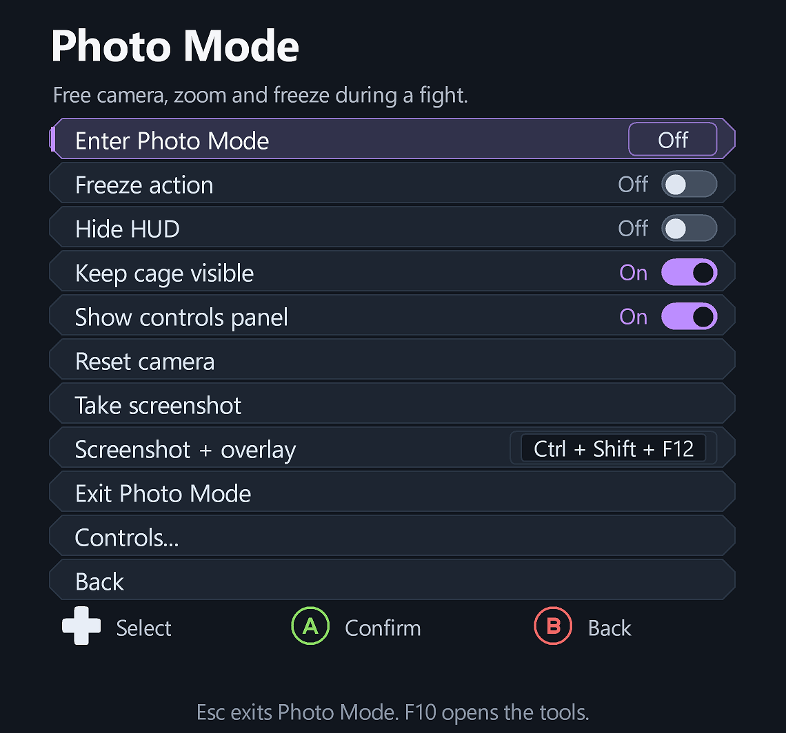
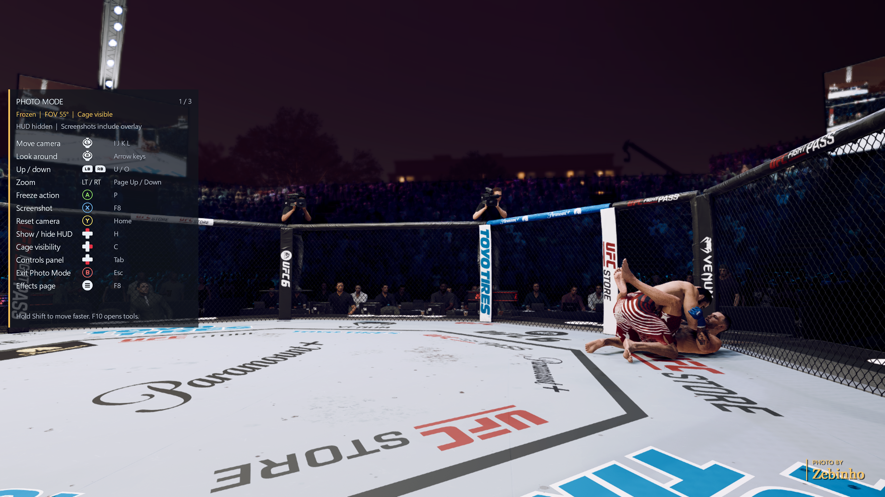
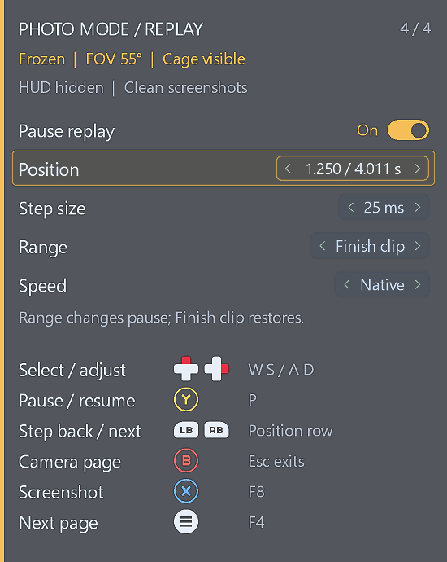

# Photo Mode

Photo Mode is available in the overlay's main menu and through F9 in a running fight, practice or the game's View Replay. It is enabled only for the verified engine and matching game-code signatures. Unsupported code leaves the normal game camera intact.

## Controls and tools

Use the sticks to move/look, bumpers for height and triggers for field of view. A/Cross freezes, X/Square takes a screenshot, Y/Triangle resets and B/Circle exits. D-pad Up toggles the game HUD, Right toggles native cage fading versus a fully visible cage, Down toggles the controls panel and Left has no built-in action. Controller camera controls apply with the tools menu closed. F10 opens the tools.

Keyboard equivalents are I/J/K/L, arrow keys, U/O, Page Up/Page Down, P, Home, H, C, Tab and Esc. Hold Shift for faster movement. Overlay-inclusive capture is an opt-in setting, with no separate shortcut. Photo Mode and screenshot action keys can be changed in Keybinds; existing assignments are preserved.

## Screenshots

**Take screenshot** is clean by default. To photograph the overlay itself, enable **Settings → Files & support → Include overlay in screenshots**. The normal screenshot action/button/key then includes the displayed controls panel or tools menu. Switch it Off to return to clean captures. There is no separate overlay-shot action, default keyboard/controller shortcut or Camera-panel shortcut hint. Existing normal screenshot bindings are preserved; retired `ScreenshotOverlayKey/Pad` entries are ignored. PNGs save in Windows Pictures\Screenshots. Startup recognition always receives the clean pre-overlay game frame; capture feedback appears after the requested image has been taken.

## Translucent editor pages

While Photo Mode is active, press **Menu (Xbox) / Options (PlayStation)** or **F8** to cycle **Camera → Effects → Watermark → Replay → Presets** without opening the full tools. Replay appears only during replay playback; Presets follows Watermark otherwise. The panel appears if hidden. The Camera page keeps the original photo controls. On editor pages, use **D-pad Up/Down** to select a row and **Left/Right** to adjust; **A/Cross** also advances or activates the selected value. Keyboard equivalents are **W/S** and **A/D**. The sticks, bumpers and triggers still move/look/zoom the camera. **B/Circle** returns to the Camera page; a second press exits. **Esc** exits directly. **P** still freezes/unfreezes. **X/Square** takes a screenshot on every panel page and follows the optional Include overlay in screenshots setting. Tab hides/shows the panel. While the panel is hidden, controller buttons use the original Camera mapping. Assigned user keybinds retain priority.

## Filters, effects and watermark

Open **Photo Mode → Filters & effects**. Use left/right or confirm to change a value. Presets include Vivid, Cinematic, Warm, Cool, Monochrome and Sepia, with adjustable filter strength. Exposure, contrast, saturation, warmth, vignette, film grain and 2.35:1 / 2.76:1 cinematic bars are independent. **Reset effects** returns the image to neutral without changing your watermark. Settings are saved between launches but only applied while Photo Mode is active. Exit or switch away to restore the normal game image.

**Photo Mode → Watermark** adds your PORTHEON player name, with four corner positions, opacity and Small/Medium/Large sizes. Choose **Clean**, **Glass**, **Editorial** or **Signature** styling and **Modern**, **Condensed**, **Serif** or **Mono** fonts. Lettering is cached at double resolution and filtered on the GPU for sharper scaling. It starts Off; the detected name is shown before enabling it. The overlay reads only `[UFC6] user` from the launcher's `UFC6.ini`, never your Windows login. If no player name is found, it leaves the watermark Off. An optional `[Photo] WatermarkText=Your name` entry in `bin/ufc6-quit-menu.ini` supplies custom text (restart to reload); other launchers can use this too.

Screenshots retain the photo effects and watermark in both capture modes. With Include overlay in screenshots Off, tools/panel are excluded; On adds them in their original colors. Photo grading runs on the GPU, without continuous CPU frame readback. Film grain is spatially stable while the action is frozen. Cinematic bars cover the frame without cropping the saved resolution. These are image effects; they do not add depth-based focus or lens simulation.

Shader sources are in `src/shaders/photo_effects.*`, with committed SPIR-V for normal builds. To regenerate, run `python scripts/generate_photo_effects_shaders.py --compiler path/to/glslang.exe` using [Khronos glslang](https://github.com/KhronosGroup/glslang).

On the **Presets** page, choose one of three slots and select **Save current look** or **Apply preset**. Presets store filters, watermark styling, field of view, HUD and cage choices in `bin/ufc6-quit-menu.ini`. Applying a preset uses the current PORTHEON player name. Camera position is specific to the current fight and is not stored. **Reset overlay settings** clears the slots.

## Restoration and limitations

- Exiting or switching away from the game restores normal camera, field of view, game speed and HUD behavior. The original native cage-fade values continue to update and are restored when the override ends.
- Opening the tools stops camera movement and preserves your selected HUD visibility. It does not automatically show/hide the game HUD when entering or leaving the tools; use the explicit HUD switch, or exit Photo Mode to restore normal behavior.
- Freezing also stops the game's cage-update graph. Briefly unfreeze after changing the cage option to process the change.
- The controls panel uses the current theme, controller artwork, font and scale. It can be hidden independently without leaving Photo Mode.
- Photo Mode works in a running fight or practice and in the native replay viewer when a recorded moment is available. The Replay page shows measured continuous retained footage separately from the selected clip; earlier fight footage may have been trimmed.

## Validation

Live testing confirmed camera movement/look, field-of-view zoom, freezing while the camera moves, HUD hiding, cage visibility, controller navigation, smooth panel rendering and exit restoration. The shipped screenshots were captured through the installed overlay. Native tests cover identity and ownership guards, current-state restoration, page-memory checks, screenshot modes and input routing. GPU tests cover BGRA/RGBA linear and sRGB formats, alpha composition and clean startup-recognition frames.

## Replay controls

Open the game's **View Replay**, then enter Photo Mode with **F9**. Cycle the translucent panel using **Menu / Options**, **F8**, or **F4**. Assigned action bindings take priority; if F8 is your screenshot key, use F4.

The fourth **Replay** page offers **Pause replay**, **Position**, **Step size**, **Range** and **Speed**:

- **Y / Triangle** or **P** pauses/resumes. **LB / RB** (L1 / R1) steps backward/forward without moving the camera vertically on this page.
- **D-pad Up/Down** (W/S) selects a row; **Left/Right** (A/D) adjusts it. Position changes pause automatically. Resume continues from the selected moment.
- **Step size:** 10, 25, 50, 100, 250, 500 or 1000 milliseconds. The choice is saved.
- **Range:** Finish clip or Available recording. Available recording selects the continuous retained section containing the finish clip and pauses at its beginning. Pause Off plays that earlier footage. Selecting Finish clip restores its saved position.
- **Speed:** Native, 0.1×, 0.25×, 0.5×, 1× or 2×. Numbered speeds compensate for the game's cinematic slow motion; Native preserves it. Speed returns to Native on launch.
- **B / Circle** returns to Camera; **Esc** exits Photo Mode. Exiting or switching apps releases playback control and restores the native finish range.

Free camera, zoom, effects, watermark and screenshots remain usable. Pause holds both the recorded action and native cinematic state. The Replay page stays selected during temporary unavailability rather than resetting to Camera.

### Replay access and limits

Enable **Settings → Game & launcher → Replay after decisions** before a new supported offline fight. It uses valid retained clips to fill incomplete post-fight selections. A recap may repeat a clip. Decision playback, repeated entry, rematch cleanup, earlier playback, speed controls and stepping are live-tested in Parsec mode. Draw-specific testing and normal-mode live replay validation remain pending.

**Available recording does not guarantee an entire fight.** Recording buffers and continuous coverage limit what can be shown. Brief flashes at native camera cuts remain under investigation. Mid-fight instant replay is under investigation and is not included in this release.
