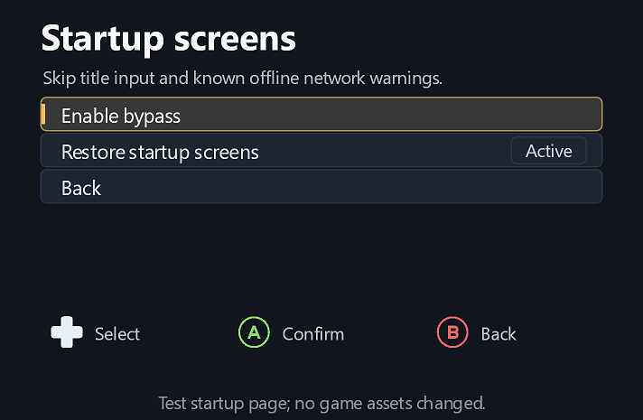
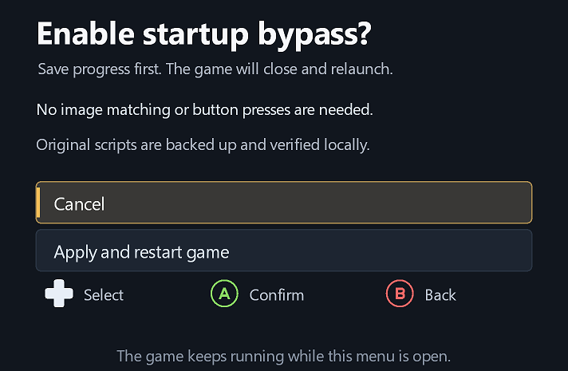

# Startup screens

Open **Settings → Game & launcher → Skip title & network warnings...**.

- **Enable bypass** uses the game's normal profile setup automatically, continues past the known PSN/EA offline warning and skips the roster check/download failure acknowledgements.
- **Restore startup screens** restores the original scripts from the verified local backup.
- Both actions require a game restart. Confirmation starts on **Cancel**; save your progress before choosing **Apply and restart game**.

The patch uses game-script transitions rather than image recognition or injected button presses. It preserves the actual offline/failure result. Other login errors remain visible. Brief startup transitions can still appear while the game initializes; it does not remove all loading work.

**Visual auto-confirm fallback** remains a separate Game & launcher switch. It can be left Off when using the native bypass. **Skip intros** controls the existing logo/legal splash bypass; its existing On/Off behavior also changes the fallback preference, which can then be adjusted independently.

## Compatibility and restoration

The initial profile supports extracted **PPSA23566, version 01.006.000** only. The helper checks metadata and exact script-range hashes before writing. It supports normal and Parsec launch executables through the configured launcher; verify controller/profile selection after changing modes.

Original script blocks are saved locally in `.ufc6-startup-screens-backup.zip` inside the extracted game folder, with integrity checks before use. Only four verified ranges are changed; archive lengths and unrelated data are preserved. A failed write is rolled back and checked. Keep this backup, especially across game updates.

Restore the scripts from this page before removing the overlay or replacing game archives. Removing overlay binaries does not undo game-asset patches. An unknown or separately modified script is rejected instead of overwritten. Updates that change those scripts need a new verified patch profile.

The distributed overlay contains recipes and hashes, with no copied game scripts or other game assets.

